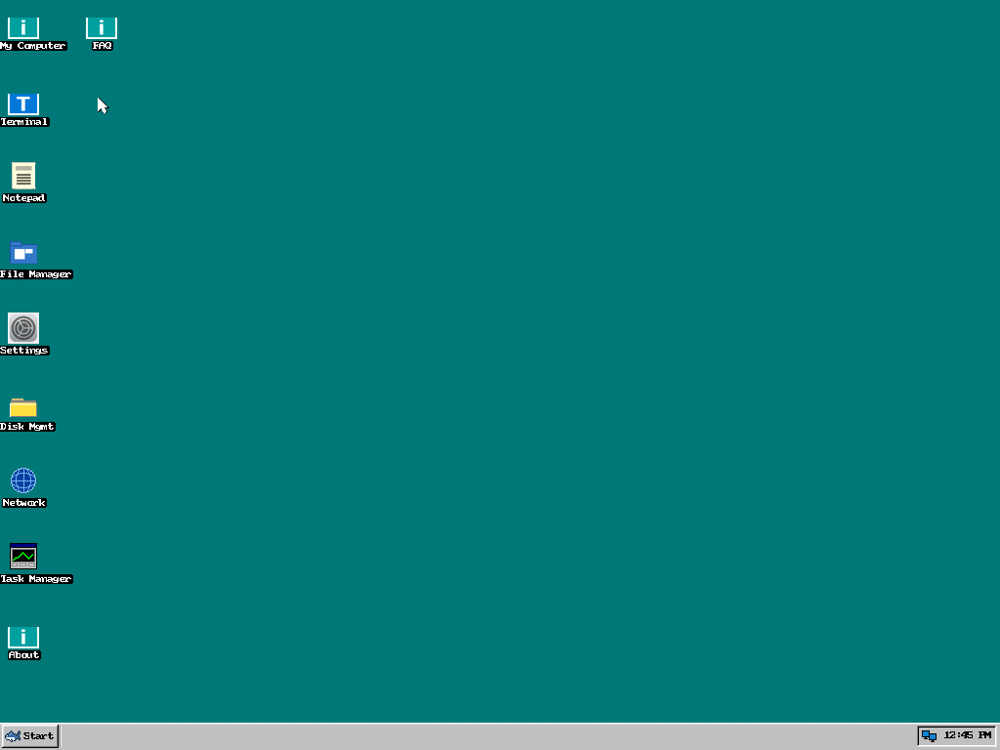
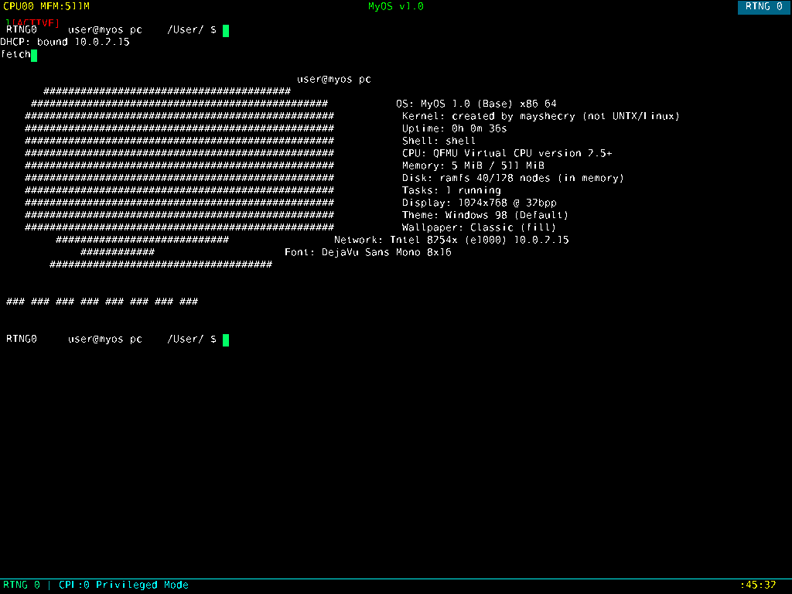

# BYOS — Build Your Own SharkOS

**BYOS is a distro-maker base built from [SharkOS](https://github.com/mayshecry/shark-os)**
by [mayshecry](https://github.com/mayshecry).

Upstream SharkOS is a complete hobby OS — kernel, drivers, desktop,
browser, games and all. BYOS takes that codebase and strips it back to
the parts every distro needs and nobody wants to rewrite:

* the **64-bit x86_64 kernel** (bootstrap, memory, interrupts, ELF loader),
* **all of the drivers** (PS/2, PCI, ATA, RTC, AC'97/HDA audio, RTL8139 /
  PCnet / e1000 networking + TCP/IP/TLS stack),
* the **desktop** (window manager, taskbar, start menu, 4 themes, icons,
  TrueType text, image decoders),
* the shell, the in-memory filesystem, and the desktop's own system
  windows (Terminal, Files, Settings, Task/Network/Disk managers…).

…and removes everything else (games, browser, scripting, plugin system,
bundled wallpapers), then makes **every name, string and file name
configurable from one file** so you can turn it into *your* OS in an
afternoon. That is the whole idea:

> **Fork it, rename it, add your stuff, ship your own ISO.**

> Kernel originally created by **mayshecry** — please keep that credit.
> It stays visible inside your distro in the About window, System Info,
> `fetch`/`sysinfo`, and `System/os-release`, even though every other
> SharkOS reference has been removed from the shipped system
> (`make verify` checks both). GPL-3.0 — see [`LICENSE`](LICENSE) and
> [`CREDITS.md`](CREDITS.md).





---

## From zero to *your* distro (10 minutes)

**1. Get the tools** (Debian/Ubuntu example):

```bash
sudo apt install build-essential xorriso qemu-system-x86
```

**2. Name your OS.** Edit [`config.mk`](config.mk) — this is the only
file you *must* touch:

```make
OS_NAME        ?= ZynxOS      # shown in boot menu, windows, shell…
OS_NAME_LOWER  ?= zynxos      # file names: zynxos.bin / zynxos.ISO
OS_VERSION     ?= 1.0
OS_CODENAME    ?= Sunrise
OS_VENDOR      ?= YourName
OS_HOSTNAME    ?= zynx-pc
OS_DEFAULT_USER?= user
```

**3. Build and boot it:**

```bash
make            # -> build/zynxos.ISO  (hybrid BIOS+UEFI, USB-bootable)
make run        # QEMU with window, audio and network
```

That's it — you now have a bootable OS with your name on the boot
screen, the start menu, the shell prompt (`user@zynx-pc`), `uname`,
`os-release`, the ISO volume label, everywhere. No find-and-replace,
no stray branding.

**4. Make it yours for real** — add things. The docs walk through each
one with copy-paste examples:

| I want to…                        | Read |
|-----------------------------------|------|
| Add a desktop app / window / game | [docs/04-desktop-and-windows.md](docs/04-desktop-and-windows.md) |
| Add a shell command               | [docs/05-shell-commands.md](docs/05-shell-commands.md) |
| Add a driver                      | [docs/06-drivers.md](docs/06-drivers.md) |
| Ship files/folders in the OS      | [docs/07-filesystem.md](docs/07-filesystem.md) |
| Make a theme / icons / wallpaper  | [docs/08-themes-icons-wallpapers.md](docs/08-themes-icons-wallpapers.md) |
| Use networking / audio from code  | [docs/09-network-and-audio.md](docs/09-network-and-audio.md) |
| Run my own ELF programs           | [docs/10-elf-programs.md](docs/10-elf-programs.md) |
| Understand how it all fits        | [docs/03-architecture.md](docs/03-architecture.md) |

**5. Release it** — follow the checklist in
[docs/11-building-and-releasing.md](docs/11-building-and-releasing.md):
`make clean && make && make verify`, boot both menu entries, tag a
version, publish the ISO **with the source** (GPL-3.0), keep the
mayshecry kernel credit.

---

## Documentation

| Doc | What's in it |
|---|---|
| [01 · Getting started](docs/01-getting-started.md) | Prerequisites, building, QEMU variants, USB/real hardware, first boot tour |
| [02 · Making your distro](docs/02-making-your-distro.md) | Every `config.mk` knob, naming rules, boot menus, versioning, forking, licensing duties |
| [03 · Architecture](docs/03-architecture.md) | Boot flow, memory model, the main loop, subsystem + file map |
| [04 · Desktop & windows](docs/04-desktop-and-windows.md) | Add windows/apps/games: draw, keyboard, mouse, tick, icons, start menu |
| [05 · Shell commands](docs/05-shell-commands.md) | Add commands, argument parsing, colours, desktop-terminal capture |
| [06 · Drivers](docs/06-drivers.md) | Add drivers: ports, PCI, IRQs, polling, DMA memory, audio/NIC backends |
| [07 · Filesystem](docs/07-filesystem.md) | Ship default files, limits, runtime file APIs, `System/Bin` |
| [08 · Themes, icons, wallpapers](docs/08-themes-icons-wallpapers.md) | New themes, converting PNGs to icon arrays, wallpaper presets & real images, fonts |
| [09 · Network & audio APIs](docs/09-network-and-audio.md) | TCP/HTTP/DNS/ping from your code; mixer channels, WAV, beeps |
| [10 · ELF programs](docs/10-elf-programs.md) | The ELF loader's exact contract, int 0x80 calls, worked example |
| [11 · Building & releasing](docs/11-building-and-releasing.md) | Makefile deep dive, adding source dirs, ISO anatomy, release checklist |
| [12 · Troubleshooting & FAQ](docs/12-troubleshooting-faq.md) | Build errors, black screens, serial/screendump debugging, gotchas |
| [13 · API quick reference](docs/13-api-reference.md) | One-page tables: kernel, desktop, widgets, net, audio, fs |

---

## What's based on SharkOS, what changed

BYOS *is* SharkOS code (GPL-3.0) with surgery. If you know the
[upstream repo](https://github.com/mayshecry/shark-os), the diff in
one breath:

* **Kept, largely untouched:** `boot.s`, arch, lib (memory/ELF),
  **every driver**, the net stack, fs, terminal UI, desktop core
  (WM/taskbar/start menu/themes/widgets/image decoders).
* **Removed:** Doom + renderer, Flappy Bird, Pong, SMB, Geometry Dash,
  FNAF, SharkCube/SharkCraft, the web browser (its TTF renderer moved
  to `src/desktop/font.c` — the desktop needs it), SharkScript, the
  plugin manager + SharkAPI + `spkg` + `plugins/`, photo wallpapers
  and `pc/` images, shell easter eggs. Wallpapers became six generated
  gradient presets behind the same API.
* **Rebranded:** every `shark*` identifier/string (~620 hits) replaced
  by `config.mk`-driven macros (`OS_NAME`, `OS_HOSTNAME`, …) — e.g.
  `THEME_DEFAULT`, `draw_logo`, the `KRNLIMG1` disk magic, prompt,
  panic banners, User-Agent. The handwritten 300-line Makefile became
  a config-driven one that auto-discovers `src/**/*.c` and generates
  `os_config.h`, `limine.conf` and `grub.cfg`.
* **Deliberately not removed:** `Kernel created by mayshecry`
  (About / System Info / `fetch` / `System/os-release` / this file).

These README/docs talk about SharkOS because BYOS is *based on* it and
you should know where to look upstream — but the system you build
contains no SharkOS branding. `make verify` proves it.

---

## Quick reference

```bash
make              # build build/<name>.ISO
make kernel       # just the kernel image
make run          # QEMU GUI + audio + net
make run-serial   # QEMU headless, serial log
make run-uefi     # QEMU + OVMF (set OVMF=path if needed)
make config       # show active name/version/switches
make verify       # no old branding, credit present, no dead apps
make clean
# one-off rename without touching files:
make OS_NAME=ZynxOS OS_NAME_LOWER=zynxos
```

Boot entries: **`<Your OS>`** (desktop) and **`<Your OS> Lite`**
(text console, same shell — try `help`, `fetch`, `ls /System`,
`cat /System/os-release`, `ping 10.0.2.2`, `wget http://…`).

## Layout

```
config.mk            YOUR distro identity — start here
Makefile             config-driven build (auto-discovers sources)
limine.conf.in / grub.cfg.in   boot menu templates
boot.s linker.ld limine/       bootstrap + Limine binaries
include/             kernel/desktop/driver headers, icons, fonts
src/arch             CPU, interrupts, I/O        src/drivers  kbd/mouse/pci/rtc/ata/audio
src/net              NICs + TCP/IP + TLS         src/lib      memory, ELF, helpers
src/fs               RAM filesystem              src/desktop  WM, windows, themes…
src/ui               text terminal (Lite)        src/shell    kmain + commands
docs/                the guides above + screenshots
build/               generated: obj/, <name>.bin, <name>.ISO, configs
```

## License

GPL-3.0 (see `LICENSE`, unchanged from SharkOS). Limine binaries are
BSD-2-Clause. If you publish your distro's ISO, publish the source
with it and keep the license + the mayshecry kernel credit — details
in [docs/02](docs/02-making-your-distro.md#license--credit-duties-the-boring-but-important-bit).

**Upstream:** SharkOS by mayshecry — <https://github.com/mayshecry/shark-os>
